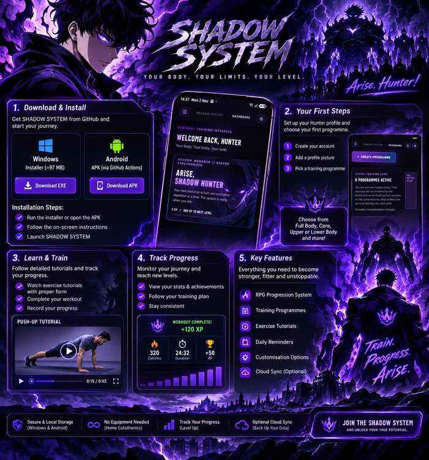
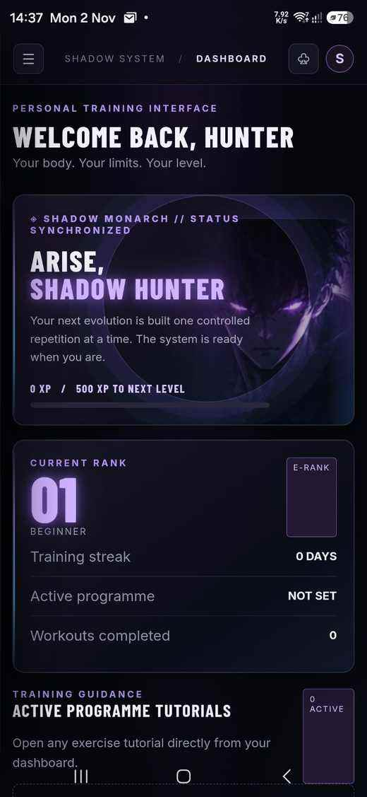
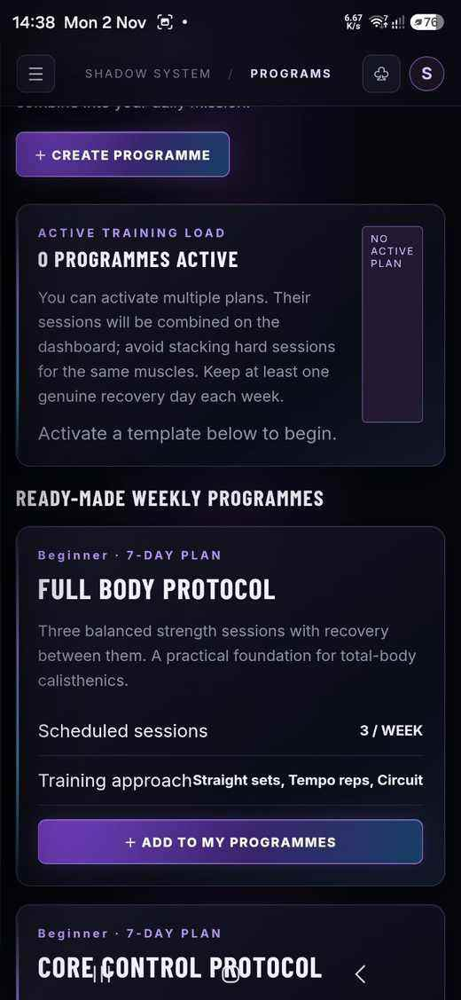

# SHADOW SYSTEM — Personal Calisthenics Training OS

Private source repository for SHADOW SYSTEM. The v0.10 release adds an optional Supabase cloud account and manual snapshot upload/restore to the existing local-first training app.


<div align="center">
  
  <h2>YOUR BODY. YOUR LIMITS. YOUR LEVEL.</h2>
  <p><em>Train. Level up. Build your Shadow Army.</em></p>
</div>

## App screenshots

| Hunter Dashboard | Training Programmes |
|:---:|:---:|
|  |  |


## Requirements
- Windows 10/11 and Node.js 22.5+
- Modern browser (Edge, Chrome, Firefox or Safari)
- No npm dependencies; uses Node built-ins including `node:sqlite`

## Run locally
1. Install Node.js 22.5+.
2. Extract the release into a writable folder.
3. Run `START-SHADOW-SYSTEM.bat`.
4. Open `http://localhost:4173`.
5. Keep the server terminal open while using the app.

## Features
- Solo Leveling / Shadow Monarch inspired dark interface and bundled artwork.
- Local username/password accounts with salted scrypt password hashes and separate local training profiles.
- Weekly programmes, exercise library, workout logging, XP, calendar, statistics, achievements and JSON backup/restore.
- Responsive PWA interface for PC and Android browsers.
- Local SQLite persistence; existing data is retained when updating.
- v0.10 optional Supabase email/password cloud identity, manual upload of the current local account snapshot, and restore on another device.

## v0.10 cloud sync setup
1. Create/use a Supabase project and apply `supabase/migrations/0001_cloud_sync.sql` in its SQL Editor.
2. Enable Email authentication. If email confirmation is enabled, confirm the registration email before logging in.
3. Open **Settings → Cloud Synchronization** in SHADOW SYSTEM.
4. Create or log into a cloud account, then choose **Upload This Device**.
5. On another installation, log into the same cloud account and choose **Restore From Cloud**.

See [CLOUD-SYNC-SETUP.md](CLOUD-SYNC-SETUP.md) for the workflow and limitations.

## Important cloud-sync limitations
- v0.10 is **manual snapshot synchronization**, not automatic two-way sync.
- Upload replaces the cloud snapshot for that cloud user. Restore replaces the current local account after confirmation. Export a local backup before restoring.
- Avoid uploading from multiple devices at the same time. Conflict-safe merging, background sync, offline write queues and automatic retries are not included.
- The local Hunter login and Supabase cloud login are separate identities.
- The Supabase URL and publishable key are client-safe configuration. Never commit a service-role/secret key, database password, local SQLite database, or user backup.
- Do not expose the local Node server directly to the public internet.

## Data safety and updates
- The database is stored in `data/shadow-system.sqlite` and is intentionally excluded from release source packages.
- **Never delete or overwrite the `data` folder** when updating an existing installation.
- Stop the server, extract the new release over the app files, keep `data`, run `START-SHADOW-SYSTEM.bat`, then hard-refresh the browser with `Ctrl+Shift+R`.
- Use Settings → Download full backup before significant changes or cloud restores.

## Native Android development

The agreed native Android direction is documented in [ANDROID-NATIVE-PLAN.md](ANDROID-NATIVE-PLAN.md). Android is being designed as a local-first Capacitor application with on-device SQLite. A native Android debug APK is built separately through GitHub Actions. See the installation instructions below. Android is still a prototype and should be treated as a test build rather than a production release. Optional cloud account creation and synchronization will remain disabled by default and must preserve existing local data when enabled.

## Native Android build

A separate GitHub Actions workflow at `.github/workflows/android.yml` builds a **debug APK** from the existing v0.10 application source and the Capacitor wrapper in `android-native/`. It runs on pushes to the `android-native-local-first` branch or by manual dispatch. The APK is published as a 30-day Actions artifact named `SHADOW-SYSTEM-Android-debug`.

The current Android prototype:
- Opens directly into a local Hunter profile without registration.
- Stores the app's local state in the Android WebView's persistent IndexedDB store and works without a network connection for core training data.
- Seeds the exercise library on first launch.
- Keeps cloud features disabled by default; users must explicitly enable them in Settings before cloud login/upload/restore controls are usable.
- Keeps the existing Windows Node.js + SQLite app unchanged.

**Important:** this is an initial native APK prototype, not the final production release. Android local persistence currently uses IndexedDB, not the planned native SQLite adapter. The current cloud feature is still manual snapshot upload/restore, not conflict-safe automatic multi-device sync. Native scheduled notifications, device-level backup testing, migration to native SQLite, and full Android device QA remain before a production-ready release. Do not use a cloud restore unless you intend to replace the corresponding local training lists; export a backup first.

## Development checks
```bash
node --check server.js
node --check public/app.js
node --check public/service-worker.js
node server.js
```
The server defaults to port 4173; set `PORT` to change it.

## Release history
- **v0.9.0** — Shadow Monarch artwork and local multi-account login with per-account profiles and training history.
- **v0.10.0** — Optional Supabase cloud identity and manual account snapshot upload/restore; service-worker cache and app asset versions updated.

## Automated GitHub release builds

The repository includes a GitHub Actions workflow at `.github/workflows/release.yml`. Relevant pushes to `main` build and publish the Windows portable package. The Windows installer workflow builds a native Electron/NSIS setup executable and uploads it to the rolling `latest` GitHub release.
- validate the app files and JavaScript syntax;
- package a clean ZIP without any personal SQLite database;
- publish a 30-day Actions artifact and update the rolling GitHub release named **latest**.

The direct download URL will be:
`https://github.com/Zero-Shad0w/SHADOW-SYSTEM/releases/download/latest/SHADOW-SYSTEM.zip`

**Release status:** the current `latest` release contains the Windows portable ZIP and the native Windows setup executable. The Android debug APK is published separately as a GitHub Actions artifact from the `android-native-local-first` branch.


## First-time user guide (no GitHub experience required)

You do not need to know how to code or use GitHub to install and use SHADOW SYSTEM. GitHub is simply where the official downloads and updates are published.

### 1. Download the app

**Windows PC — recommended for desktop users**

- Download the [SHADOW-SYSTEM Windows installer](https://github.com/Zero-Shad0w/SHADOW-SYSTEM/releases/download/latest/SHADOW-SYSTEM-Setup-1.0.0.exe).
- Alternatively, download the [portable Windows ZIP](https://github.com/Zero-Shad0w/SHADOW-SYSTEM/releases/download/latest/SHADOW-SYSTEM.zip).
- You can find both files on the [GitHub Releases page](https://github.com/Zero-Shad0w/SHADOW-SYSTEM/releases/tag/latest).

**Android phone**

- Open the [SHADOW SYSTEM GitHub Actions page](https://github.com/Zero-Shad0w/SHADOW-SYSTEM/actions).
- Select the latest successful run of the Android workflow on the `android-native-local-first` branch.
- Scroll to **Artifacts** and download `SHADOW-SYSTEM-Android-debug`.
- Extract the downloaded artifact if it is a ZIP, then open the APK on your phone and follow Android's installation prompts. You may need to allow installation from the browser or file manager used to download it.
- Only install APKs downloaded from this official repository.

The Android APK is a debug/test build distributed separately from the Windows release. It is not currently attached to the Windows release page.

### 2. Install on Windows

1. Run `SHADOW-SYSTEM-Setup-1.0.0.exe`.
2. Follow the setup wizard and choose an installation folder.
3. Finish installation.
4. Start **SHADOW SYSTEM** from the Desktop shortcut or Windows Start Menu.

The Windows desktop app opens in its own application window and starts its local training server automatically. You do not need to open a browser or manually start the server.

### 3. First launch and Hunter profile

1. Open SHADOW SYSTEM.
2. Create your Hunter account or sign in with your existing local account.
3. Open Settings and add a profile picture if you wish.
4. Explore the dashboard and exercise library.

Keep your login details safe. Your local Hunter account and optional cloud account are separate.

### 4. Choose a training programme

Choose a programme that matches your training goal:

- **Full Body** — train the major muscle groups.
- **Core** — focus on abdominal and trunk strength.
- **Upper Body** — focus on pushing and upper-body strength.
- **Lower Body** — focus on legs and lower-body strength.
- **Mobility** — work on movement, flexibility and recovery.

For a new user, start with one programme and build a consistent routine before adding more.

### 5. Complete your first workout

1. Open your active programme or the dashboard.
2. Check the scheduled exercises, sets and repetitions.
3. Tap **Tutorial** beside an exercise to open its instructions directly.
4. Follow the tutorial and perform the movement with controlled technique.
5. Record the workout when you finish.
6. Return to the dashboard to review your training progress.

Do not rush repetitions. Use a suitable difficulty level, focus on good form, and stop if you feel sharp pain.

### 6. Understand the dashboard

The dashboard is your Hunter control centre. Depending on your active programmes and progress, it helps you review:

- Upcoming and completed training.
- Active-programme exercise tutorials with direct Tutorial access.
- Training progress, activity and achievements.
- Reminders and your scheduled sessions.

### 7. A simple first-week routine

Use this as a gentle example of how to establish a habit. Follow the selected programme's own schedule and adjust the workload to your current ability.

| Day | Suggested activity |
| --- | --- |
| Monday | Full Body |
| Tuesday | Rest |
| Wednesday | Full Body |
| Thursday | Rest |
| Friday | Full Body |
| Saturday | Light mobility |
| Sunday | Rest and review progress |

Rest days are part of training. Beginners should prioritize consistency, recovery and controlled technique over doing as many repetitions as possible.

### 8. Keep your training data safe

- On Windows, keep the existing `data` folder when updating the portable installation. Do not delete it; it contains your local training database.
- Use the app's backup option before major changes or cloud restores.
- Cloud synchronization is optional and is not enabled by default on the Android prototype.
- The v0.10 cloud feature is manual snapshot upload/restore, not automatic two-way synchronization. Read [CLOUD-SYNC-SETUP.md](CLOUD-SYNC-SETUP.md) before using it.
- Do not uninstall or replace an installation until you have backed up any training data you want to keep.

### Official download links

- [Windows installer (.exe)](https://github.com/Zero-Shad0w/SHADOW-SYSTEM/releases/download/latest/SHADOW-SYSTEM-Setup-1.0.0.exe)
- [Windows portable ZIP](https://github.com/Zero-Shad0w/SHADOW-SYSTEM/releases/download/latest/SHADOW-SYSTEM.zip)
- [Android Actions builds and APK artifacts](https://github.com/Zero-Shad0w/SHADOW-SYSTEM/actions)
- [All GitHub releases](https://github.com/Zero-Shad0w/SHADOW-SYSTEM/releases)
